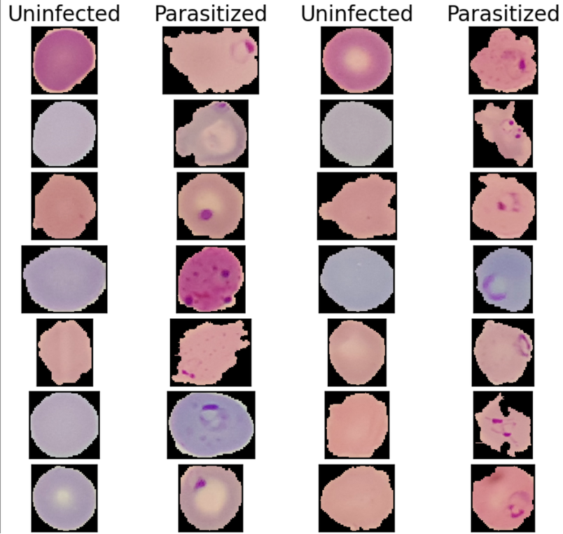

# Malaria Cell Classification with CNNs and Transfer Learning

Classifying single red blood cell images as **parasitized** or **uninfected** with TensorFlow/Keras: a baseline convolutional neural network (CNN), image preprocessing experiments, and transfer learning with Xception and EfficientNetB7.

This is a research project completed in fall 2023. The notebooks keep their saved outputs from the original runs.



*Sample cells from the training set (notebook 01). Parasites usually show as dark purple spots, but not every parasitized cell has a visible spot.*

## Results at a glance

The best model uses EfficientNetB7, pretrained on ImageNet and frozen, with a small dense classifier on top. On the 2,600-image test set:

- Accuracy 0.96 and ROC AUC 0.99
- At the threshold chosen from the ROC curve (0.61), it caught 1,253 of 1,300 infected cells (96.4%) and correctly cleared 1,235 of 1,300 uninfected cells (95.0%)

The training and test sets share no images, but the split was made by cell, so every test patient also has other cells in the training set. These numbers may therefore be higher than the model would score on new patients; see [Limitations](#limitations).

These figures count infected cells as positive, as intended. The notebooks themselves count the classes the other way round; see [the label-order note](#a-label-order-issue-found-in-review).

## Data

The images come from the NIH/NLM malaria dataset: 27,558 single-cell images (13,779 parasitized, 13,779 uninfected) cropped from Giemsa-stained thin blood smears. NLM describes the source as 150 *P. falciparum*-infected and 50 uninfected patients at Chittagong Medical College Hospital, Bangladesh. The full image set is not stored in this repository.

1. Download `cell_images.zip` (about 350 MB) from the [NLM malaria datasheet page](https://lhncbc.nlm.nih.gov/LHC-research/LHC-projects/image-processing/malaria-datasheet.html). Direct link: https://data.lhncbc.nlm.nih.gov/public/Malaria/cell_images.zip
2. Unzip it. You get `cell_images/Parasitized/` and `cell_images/Uninfected/`.
3. Rebuild the exact train/test split used in this project:

   ```bash
   python data/prepare_data.py --source cell_images --dest data/cell_images
   ```

The project used a fixed split of 12,479 images per class for training and 1,300 per class for testing. [`data/test_split.csv`](data/test_split.csv) lists the 2,600 test images; every other image is training data. The training and test sets share no images. Inside the notebooks, 25% of the training folder is held out for validation (seed 42), giving 18,719 training and 6,239 validation images.

Image sizes vary (each side is between 40 and 394 pixels), so every model resizes images to 224 x 224.

The [`samples/`](samples) folder has four test images per class from this dataset, courtesy of the U.S. National Library of Medicine. Dataset reference:

> Rajaraman S, Antani SK, Poostchi M, Silamut K, Hossain MA, Maude RJ, Jaeger S, Thoma GR. Pre-trained convolutional neural networks as feature extractors toward improved malaria parasite detection in thin blood smear images. *PeerJ*. 2018;6:e4568. https://doi.org/10.7717/peerj.4568

## Approach

| Notebook | What it does |
|---|---|
| [01_data_exploration](notebooks/01_data_exploration.ipynb) | Image metadata (all RGB PNG), sample grids, color and grayscale histograms, histogram equalization |
| [02_baseline_cnn](notebooks/02_baseline_cnn.ipynb) | Baseline CNN: rescaling layer, three Conv2D (32 filters, 3 x 3) and max-pooling blocks, Dense(128), sigmoid output; Adam, 3 epochs (a 4-epoch run began to overfit) |
| [03_image_enhancement](notebooks/03_image_enhancement.ipynb) | A/B tests of preprocessing with the baseline architecture: gamma correction (gamma 1.2), contrast enhancement (factor 2), and both together |
| [04_cnn_experiments](notebooks/04_cnn_experiments.ipynb) | CNN variants listed in the final report: Leaky ReLU and ELU activations, more filters per block, dropout, a fourth convolutional block, learning-rate schedules, early stopping, and the Adam, Adagrad and RMSprop optimizers. The notebook keeps several variants as commented-out cells; its last saved run is an ELU model with random rotation |
| [05_transfer_learning_xception](notebooks/05_transfer_learning_xception.ipynb) | Xception (ImageNet, frozen) with global average pooling, dropout 0.2 and Dense(64); Adam with a step learning-rate schedule, 10 epochs |
| [06_transfer_learning_efficientnetb7](notebooks/06_transfer_learning_efficientnetb7.ipynb) | EfficientNetB7 (ImageNet, frozen) with global average pooling and Dense(256); RMSprop (learning rate 1e-4), 15 epochs (early stopping on validation loss was set but did not trigger) |

Models are compared on accuracy, ROC AUC, precision and recall. An operating threshold is then picked from the ROC curve with Youden's J statistic (true positive rate minus false positive rate). The [final report](report/final_report.pdf) walks through the full process.

## Results

Test set (2,600 images), default 0.5 threshold, as listed in the final report:

| Model | Notebook | Accuracy | ROC AUC |
|---|---|---|---|
| Baseline CNN | 02 | 0.95 (1) | 0.98 |
| Baseline + gamma correction and contrast enhancement | 03 | 0.95 | 0.98 |
| Best CNN variant: gamma correction, fourth conv block, dropout | 04 (2) | 0.95 | 0.99 |
| Xception | 05 | 0.93 | 0.98 |
| **EfficientNetB7** | 06 | **0.96** | **0.99** |

(1) The report gives 0.945; the saved output in notebook 02 shows 0.944.
(2) These figures appear in the final report but in no saved notebook output. The saved run in notebook 04 is a different variant (ELU activations, random rotation, more filters and dropout) that trained poorly: accuracy 0.93, ROC AUC 0.97.

EfficientNetB7 by class, at two thresholds:

| Threshold | Sensitivity: infected cells caught | Specificity: uninfected cells cleared | Accuracy |
|---|---|---|---|
| 0.61, ROC knee (Youden's J) | 1,253 of 1,300 (96.4%) | 1,235 of 1,300 (95.0%) | 95.7% |
| 0.40, the report's final choice | 1,231 of 1,300 (94.7%) | 1,255 of 1,300 (96.5%) | 95.6% |

The 0.61 counts are from the final report; the 0.40 counts are in the output of notebook 06.

### A label-order issue found in review

The project was set up with parasitized as the positive class, the usual convention in diagnostics. The report defines parasitized = 1, and the threshold step in notebooks 04 to 06 lowers the threshold to raise recall for infected cells.

Keras reversed this without warning. When `image_dataset_from_directory` is not given a class order, it numbers the folders alphabetically, so `parasitized` became 0 and `uninfected` became 1. The notebooks print `class_names` as `['parasitized', 'uninfected']`, and none of them sets the order. Every model therefore learned to output the probability that a cell is **uninfected**, and the "sensitivity", "recall" and "true positive" figures in the notebooks and the report all refer to uninfected cells.

This was confirmed in 2026 by running the saved baseline model from notebook 02 on each test folder separately. It outputs a mean of 0.10 for infected cells and 0.94 for uninfected cells, and through the notebook's own loader it reproduces notebook 02's accuracy (0.944) and ROC AUC (0.981) exactly.

The by-class table above restates the results with parasitized as the positive class, as intended. Read that way, the threshold change had the opposite of its intended effect: moving from 0.61 to 0.40 raised missed infected cells from 47 to 69 and lowered false alarms from 65 to 45. For screening, where a missed infection costs most, 0.61 is the better of the two operating points. Accuracy and ROC AUC do not depend on which class is labeled 1.

The fix, not applied to these notebooks, is one argument in each loader call: `class_names=['uninfected', 'parasitized']`.

## Limitations

- **New cells, not new patients.** The training and test sets share no images. However, the split was made by cell rather than by patient, so every patient in the test set (identified by the patient ID in each file name, for example `C100P61ThinF`, as in NLM's patient-to-cell mapping) also has other cells in the training set. Cells from one patient share that slide's staining, and patients differ widely in their mix of infected and uninfected cells (50 contributed only uninfected cells), so a model can partly learn to recognize a patient's slide. The dataset's authors reported higher accuracy for a cell-level evaluation (0.986) than for patient-level cross-validation (0.959) with the same model (Rajaraman et al. 2018, cited under [Data](#data)). Performance on new patients was not measured in this project.
- **Thresholds and model choice were based on test results.** The ROC thresholds and the choice of final model were made from the test set rather than the validation set, so the test figures are somewhat optimistic.
- **No saved weights for the best model.** Saving EfficientNetB7 failed at the end of its run, so reproducing it means retraining (15 epochs, roughly 8 hours on the Colab runtime used).
- **One data source.** All images come from one hospital's slides. Performance on slides from other labs, stains or microscopes is untested.
- **Research prototype.** This is a research project, not a diagnostic tool.

## Notes on the code

- All models set `BinaryCrossentropy(from_logits=True)` on a sigmoid output layer. Keras 2 detects this case and computes the loss from the values before the sigmoid, so training was not affected (the logged losses confirm it), but the flag should be `False`.
- The confusion-matrix plots in notebooks 04 to 06, also shown in the report, put the counts under the wrong axis labels. The counts printed beside them are correct.

## Reproducing

1. Create a Python 3.10 environment on Linux, Windows or an Intel Mac and install the pinned versions: `pip install -r requirements.txt`. On an Apple Silicon Mac, TensorFlow 2.12 is published as `tensorflow-macos==2.12.0`; use it in place of `tensorflow`. The model diagrams (`keras.utils.plot_model`) also need the Graphviz program. TensorFlow 2.16 and later ship Keras 3, which these notebooks predate.
2. Prepare the data as described in [Data](#data).
3. The notebooks were written for Google Colab and read data from Google Drive. In the first code cell of each notebook:
   - set `myDataPath` to your data folder, with a trailing slash (for example `"../data/cell_images/"`);
   - in notebooks 02 to 06, set `myModelsPath` to an existing folder for saved models;
   - delete the `!pip install -U seaborn-image` line so the pinned version stays in place;
   - outside Colab, delete the lines that import `google.colab` or call `drive.mount` (notebook 01 has one more in a later cell).
4. Run the notebooks in order. Notebooks 03 and 04 pick the preprocessing through flags (`IMAGE_ENHANCEMENT`, `GAMMA`, `CONTRASTS`) in their "Set runtime parameters" cell. Notebook 04 runs its last experiment as saved (accuracy 0.93); the variants behind the report's best CNN result are kept as commented-out cells, and which one produced it is not recorded.

Expect small differences from the saved results: training is not bit-for-bit repeatable.

## Repository contents

```
notebooks/            the six project notebooks, with outputs
report/               final report (PDF)
data/test_split.csv   the 2,600 test images
data/prepare_data.py  rebuilds the train/test folders from the NIH download
samples/              four test images per class
figures/              sample-cell figure from notebook 01, used above
requirements.txt      pinned package versions
```

The notebooks were originally named `EDA_01` to `EDA_06`. One leftover test cell with no effect on the analysis was removed from notebook 06, and the Google Drive folder in the data paths was renamed to `My Drive/Malaria/`. This README, `requirements.txt` (versions reconstructed from the notebook outputs), `data/prepare_data.py`, `data/test_split.csv` and the `samples/` folder were added in 2026 when the project was published.

## License

The notebooks and code are released under the [MIT License](LICENSE). The final report is © 2023 Scott Stearns. The sample images in `samples/` are from the NIH/NLM dataset described in [Data](#data).

## Author

Scott Stearns ([@scottdstearns](https://github.com/scottdstearns))
